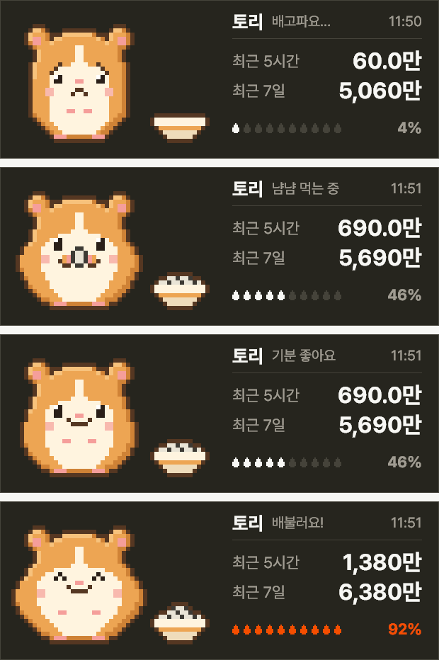

# TokenHamster (토리 사용량 위젯)

Claude Code에 쓴 토큰으로 픽셀 햄스터 토리에게 밥을 주는 Windows 바탕화면 위젯이에요.


Claude Code를 쓰면 토리가 해바라기씨를 먹어요. 몇 시간 안 쓰면 배고파해요. 최근 5시간과 최근 7일 동안 쓴 토큰 수도 같이 보여 줘요.

화면 사진은 지어낸 예시 기록으로 찍은 거예요. 실제 사용량이 아니에요.

영어 화면도 지원해요. Windows 표시 언어를 따라가고, 오른쪽 클릭 > English로 바꿀 수 있어요. 영어 화면 사진은 [README](README.md)에 있어요.

[English](README.md)

## 보여 주는 것



| 상태 | 언제 |
|---|---|
| 먹는 중 | 최근 3분 안에 토큰을 썼을 때 |
| 배고픔 | 최근 5시간 사용량이 평소 최대치의 15% 미만일 때 |
| 보통 | 15%와 80% 사이일 때 |
| 배부름 | 80% 이상일 때 |

"평소 최대치"는 내 지난 7일 중 가장 많이 쓴 5시간이에요. 씨앗 10개가 이 값을 기준으로 차고, 80%에서 주황, 95%에서 빨강으로 바뀌어요.

Anthropic 공식 사용 한도가 아니에요. 위젯은 요금제 한도를 알 수 없어서 내 최근 기록과 비교해요.

## 설치

Releases 페이지에서 `TokenHamster_v1.1.0.zip`을 받아 압축을 풀고 `TokenHamster.exe`를 실행해요. 설치 과정은 없어요.

서명이 없는 파일이라 "Windows의 PC 보호" 창이 떠요. **추가 정보**를 누르고 **실행**을 누르면 돼요. 서명 없는 exe가 꺼려지면 아래처럼 소스로 실행하세요.

처음 켜면 지난 7일 기록을 읽느라 시간이 걸릴 수 있어요. 다음부터는 바로 떠요.

### 소스로 실행하기

Windows 10·11과 Python 3이 필요해요. Python 3.12에서 시험했어요.

```
pip install pillow
python widget.py
```

## 쓰는 법

- 위젯을 끌어서 옮겨요. 위치는 기억돼요.
- 마우스를 올리면 모델별 토큰 수가 떠요.
- 오른쪽 클릭 메뉴에 새로고침, 이름 바꾸기, 위치 초기화, 언어(English / 한국어), 진단 정보 저장, 종료가 있어요.
- 이름 바꾸기로 햄스터 이름을 8자까지 정할 수 있어요.

## 읽고 저장하는 것

- 내 컴퓨터의 `%USERPROFILE%\.claude\projects` 아래 Claude Code 기록을 읽어요. `CLAUDE_CONFIG_DIR` 환경 변수를 설정했다면 그 폴더의 `projects`도 읽고, `settings.json`의 `log_dirs`에 적은 폴더도 읽어요. 응답마다 토큰 수, 시각, 모델 이름만 꺼내요.
- 그 숫자를 모은 캐시와 설정을 `%LOCALAPPDATA%\TokenHamster`에 저장해요(소스로 실행하면 `widget.py` 옆). 같은 응답을 두 번 세지 않으려고 기록 파일의 경로와 응답 번호도 캐시에 같이 적어요. 대화 내용은 저장하지 않아요.
- 인터넷 요청을 하지 않아요. 서버도 계정도 없어요.

## 숫자가 0이거나 "기록을 못 찾았어요"가 뜰 때

지난 8일 안에 바뀐 기록 파일을 하나도 못 찾으면 위젯이 "기록을 못 찾았어요"를 띄우고 숫자를 `—`로 보여 줘요.

- 웹 claude.ai만 쓰면 이 컴퓨터에 기록이 없어요. Claude Code(터미널)나 데스크톱 앱 Code 탭을 써야 해요.
- WSL이나 다른 폴더에 기록이 있으면 `%LOCALAPPDATA%\TokenHamster\settings.json`(소스로 실행하면 `widget.py` 옆)에 `log_dirs`로 경로를 알려 주세요. WSL 안쪽은 멈출 수 있어서 자동으로 찾지 않아요. 역슬래시는 두 번씩 써요.

  ```json
  {
    "log_dirs": [
      "\\\\wsl.localhost\\Ubuntu\\home\\me\\.claude\\projects",
      "D:\\claude-logs\\projects"
    ]
  }
  ```

- 그래도 안 되면 위젯을 오른쪽 클릭하고 **진단 정보 저장**을 눌러요. 바탕화면에 `TokenHamster_진단.txt`가 생기니 만든 사람에게 보내 주세요. 폴더 위치, 파일 개수, 로그 줄의 키 이름만 들어 있고 대화 내용은 없어요. 경로 속 사용자 이름은 `%USERPROFILE%`로 가려요. 소스로 실행했다면 `python widget.py --diagnose`로도 볼 수 있어요.

## 한계

- 이 컴퓨터의 Claude Code와 Claude 데스크톱 앱 Code 탭 사용량만 세요. claude.ai 웹이나 다른 컴퓨터에서 쓴 양은 빠져요.
- 토큰은 입력 + 캐시 쓰기 + 출력이에요. 캐시 읽기는 양이 아주 많아서 뺐어요.
- Windows 전용이에요.
- 지금까지 Windows 11 노트북 한 대에서만 시험했어요.

## 만든 방법

Claude Code로 만들었어요. 햄스터는 `pet/make_pet.py`가 32×32칸 픽셀로 찍어요. 그래서 자세 하나를 바꿀 때 그림 파일을 새로 그리지 않고 코드 몇 줄만 고쳐요.

## 지우기

위젯을 종료하고 `TokenHamster.exe`와 `%LOCALAPPDATA%\TokenHamster` 폴더를 지워요.

## 알림

TokenHamster는 개인이 만든 프로그램이고 Anthropic과 관계가 없어요. Claude는 Anthropic의 상표예요.

MIT 라이선스로 공개해요.
