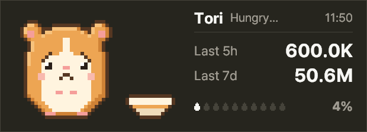
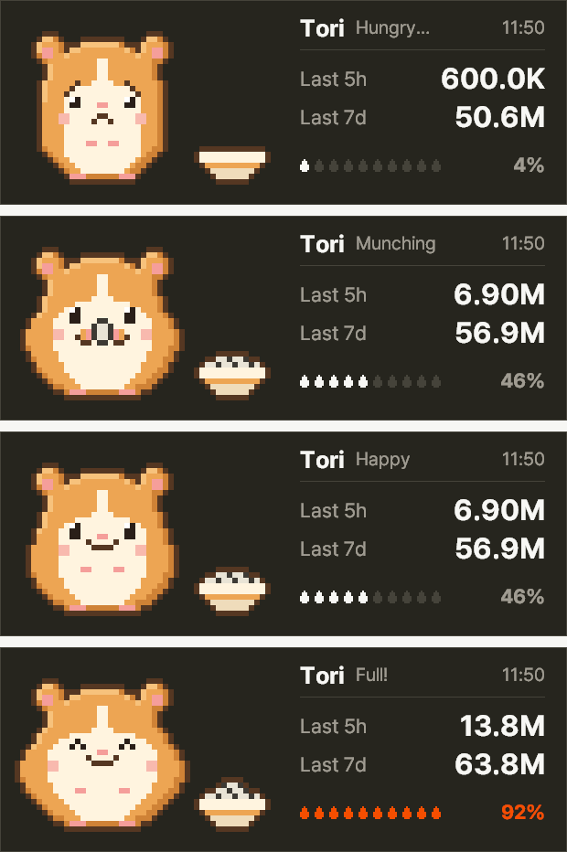

# TokenHamster

A small Windows desktop widget that feeds a pixel hamster with the tokens you spend in Claude Code.



When you use Claude Code, Tori eats sunflower seeds. Leave it alone for a few hours and Tori gets hungry. The widget also shows how many tokens you used in the last 5 hours and the last 7 days.

The screenshots use made-up example logs, not real usage.

The widget follows your Windows display language (English or Korean). To switch, right-click it and choose **한국어** or **English**.

[한국어 설명](README.ko.md)

## What it shows



| State | When |
|---|---|
| Eating | You used tokens in the last 3 minutes |
| Hungry | Last 5 hours is under 15% of your usual peak |
| Content | Between 15% and 80% |
| Full | 80% or more |

"Usual peak" is the busiest 5-hour stretch in your own last 7 days. The ten seeds fill up against that number, turn orange at 80% and red at 95%.

This is not Anthropic's official usage limit. The widget cannot see your plan limits. It only compares you with your own recent history.

## Install

Download `TokenHamster_v1.1.0.zip` from the Releases page, unzip it, and run `TokenHamster.exe`. There is no installer.

Windows shows a "Windows protected your PC" screen because the file is not code-signed. Click **More info**, then **Run anyway**. If you would rather not run an unsigned exe, run it from source instead.

The first start reads your last 7 days of logs and can take a while. Later starts are fast.

### Run from source

Requires Windows 10 or 11 and Python 3. I tested with Python 3.12.

```
pip install pillow
python widget.py
```

### Running on macOS

Requires Python 3 with Tk 8.6+ and Pillow. See [README.mac.md](README.mac.md) for details.

```bash
brew install python-tk
python3 -m pip install pillow
python3 widget.py
```

You can also run `./build_mac.sh` to package a standalone `TokenHamster.app`.

## Using it

- Drag the widget to move it. The position is remembered.
- Hover to see token counts per model.
- Right-click for refresh, rename, reset position, language (English / 한국어), save diagnostics, and quit.
- Rename gives your hamster its own name, up to 8 characters.

## What it reads and stores

- It reads the Claude Code session logs on your PC, under `%USERPROFILE%\.claude\projects`. If `CLAUDE_CONFIG_DIR` is set it also reads `projects` inside that folder, plus any folders you list under `log_dirs` in `settings.json`. From each response it takes the token counts, the timestamp, and the model name.
- It stores a cache of those numbers and your settings in `%LOCALAPPDATA%\TokenHamster` (next to `widget.py` when run from source). The cache also keeps each log file's path and each response's ID so nothing is counted twice. It does not store conversation text.
- It makes no network requests. There is no server and no account.

## If it shows nothing

If the widget says "No logs found" and shows `—`, it found no log file changed in the last 8 days.

- If you only use claude.ai in the browser, there are no local logs to read. Use Claude Code in a terminal or the Code tab of the desktop app.
- If your logs live in WSL or another folder, list that folder under `log_dirs` in `%LOCALAPPDATA%\TokenHamster\settings.json` (next to `widget.py` when run from source). WSL is not scanned automatically because it can hang. Escape backslashes:

  ```json
  {
    "log_dirs": [
      "\\\\wsl.localhost\\Ubuntu\\home\\me\\.claude\\projects",
      "D:\\claude-logs\\projects"
    ]
  }
  ```

- Otherwise right-click the widget and choose **Save diagnostics**. It writes `TokenHamster_diagnostics.txt` (`TokenHamster_진단.txt` in Korean) to your Desktop. Send that file to the author. It has folder locations, file counts and log key names, but no conversation text, and your user name is masked as `%USERPROFILE%`. From source you can also run `python widget.py --diagnose`.

## Limits

- Counts only Claude Code and the Code tab of the Claude desktop app on this PC. Usage on claude.ai or on another computer is not included.
- Tokens are input + cache writes + output. Cache reads are left out because they are very large and would hide everything else.
- Tested on one Windows 11 laptop so far.

## How it was made

I built this with Claude Code. The hamster is 32×32 pixel art drawn by code in `pet/make_pet.py`, so each pose is a few changed lines rather than a separate image file.

## Uninstall

Quit the widget, then delete `TokenHamster.exe` and the `%LOCALAPPDATA%\TokenHamster` folder.

## Notes

TokenHamster is a personal project and is not affiliated with Anthropic. Claude is a trademark of Anthropic.

Released under the MIT License.
